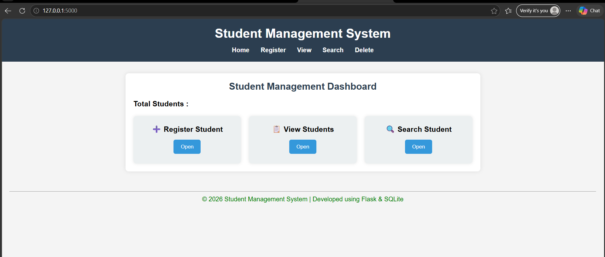
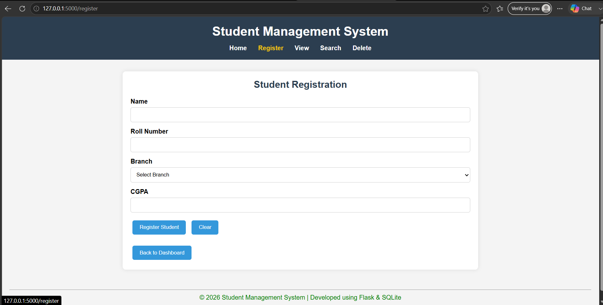
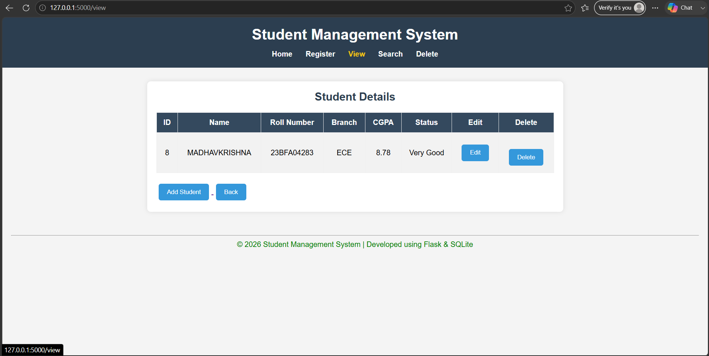
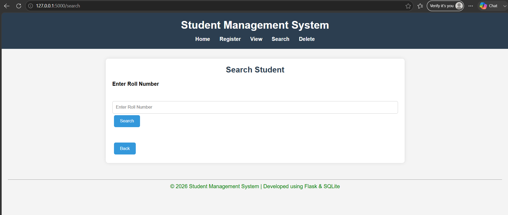
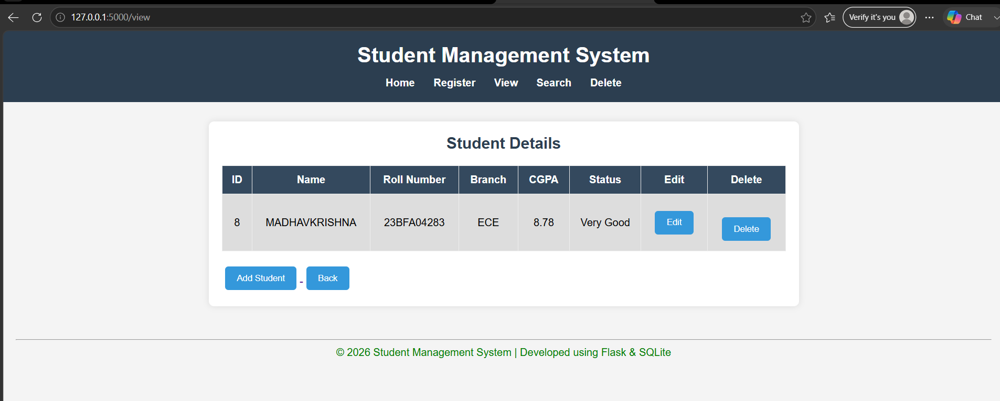

# 🎓 Student Management System

A simple web-based **Student Management System** developed using **Flask** and **SQLite**. This project was built to practice CRUD operations, Flask routing, database connectivity, and template rendering with Jinja2.

---

## 🚀 Features

* ➕ Register a new student
* 📋 View all student records
* 🔍 Search students using Roll Number
* ✏️ Update student information
* 🗑️ Delete student records
* 💬 Flash messages for user feedback
* 📱 Responsive and clean user interface

---

## 🛠️ Tech Stack

| Technology | Purpose                |
| ---------- | ---------------------- |
| Python     | Backend Programming    |
| Flask      | Web Framework          |
| SQLite     | Database               |
| HTML       | Page Structure         |
| CSS        | Styling                |
| JavaScript | Client-side Validation |
| Jinja2     | Dynamic Templates      |

---

## 📂 Project Structure

```text
Student_Management_System/
│
├── Database/
│   └── database.db
│
├── static/
│   ├── css/
│   │   └── style.css
│   └── js/
│       └── script.js
│
├── templates/
│   ├── layout.html
│   ├── dashboard.html
│   ├── register.html
│   ├── view.html
│   ├── update.html
│   └── search.html
│
├── app.py
├── database.py
└── README.md
```

---

## ⚙️ Installation

Clone the repository

```bash
git clone https://github.com/Madhavkris/Flask_Student_Management_System.git
```

Go to the project folder

```bash
cd Student_Management_System
```

Install Flask

```bash
pip install flask
```

Run the project

```bash
python app.py
```

Open your browser

```text
http://127.0.0.1:5000/
```

---

## 📸 Screenshots

### 🏠 Dashboard



### ➕ Register Student

*

### 📋 View Students



### 🔍 Search Student



### 📋 Delete Student




---

## 📚 What I Learned

During this project, I learned:

* Flask Routing
* CRUD Operations
* SQLite Database Integration
* Jinja2 Template Rendering
* Form Handling
* Flash Messages
* HTML, CSS & JavaScript Integration
* Project Structure in Flask

---

## 🔮 Future Improvements

* 🔐 Login Authentication
* 📄 Export Student Data
* 📊 Dashboard Statistics
* 🎨 Bootstrap UI
* ☁️ Deploy on Render

---

## 👨‍💻 Author

**Madhav Krishna**

B.Tech (ECE) Student

Learning Backend Development with Python & Flask
